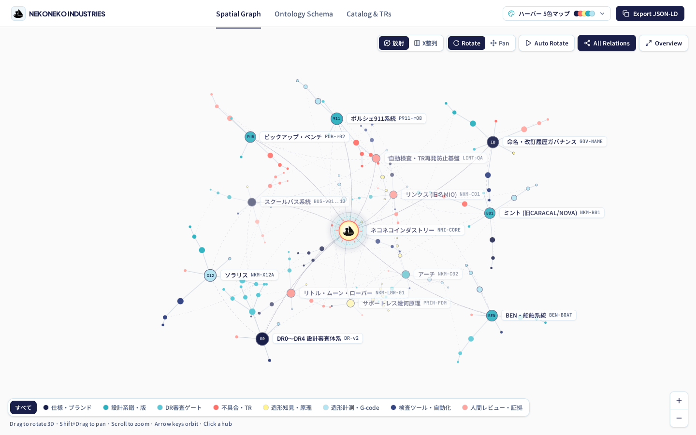
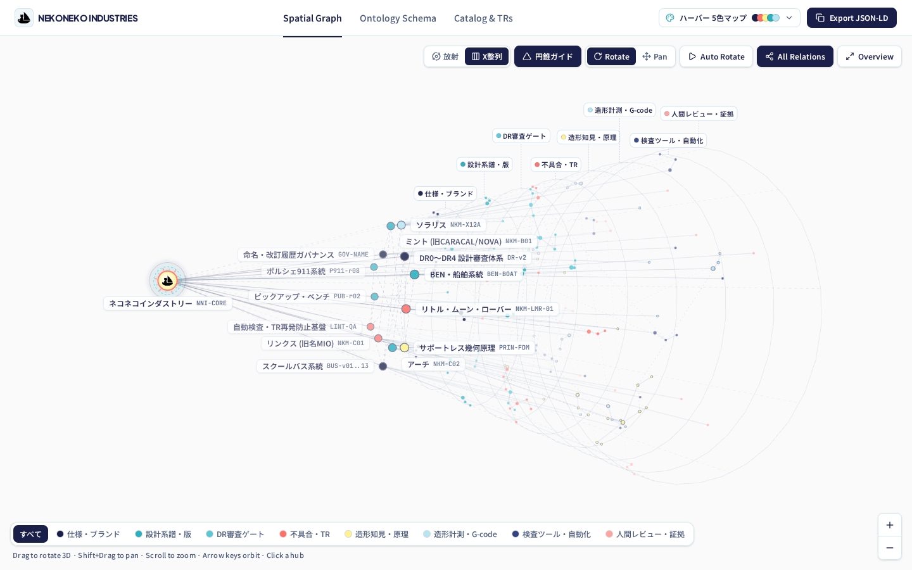
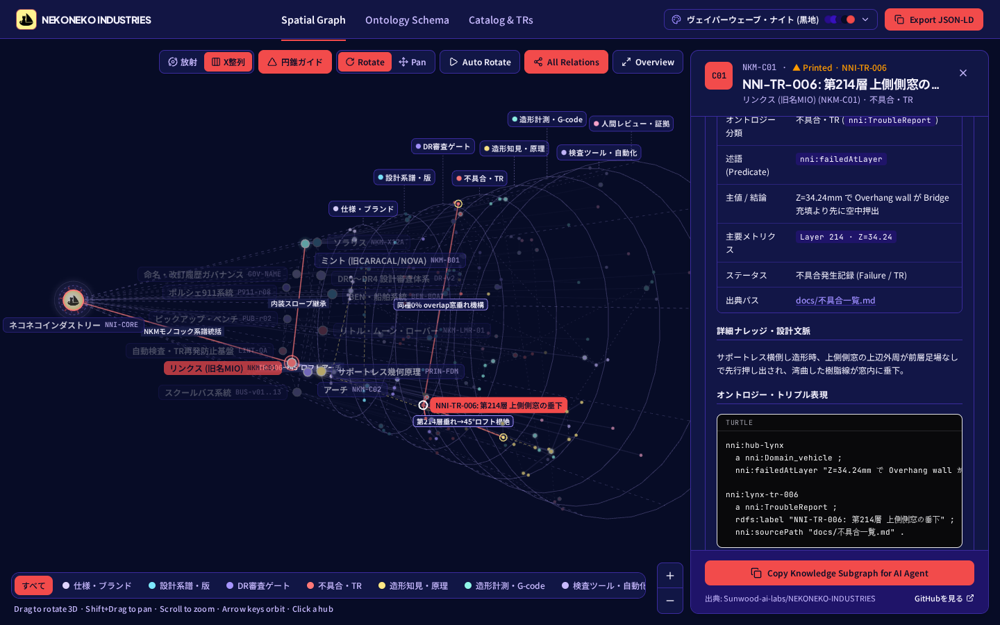
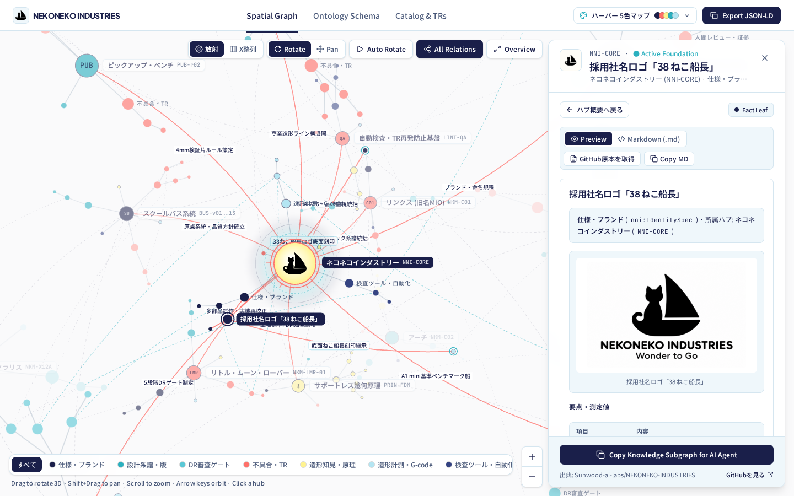
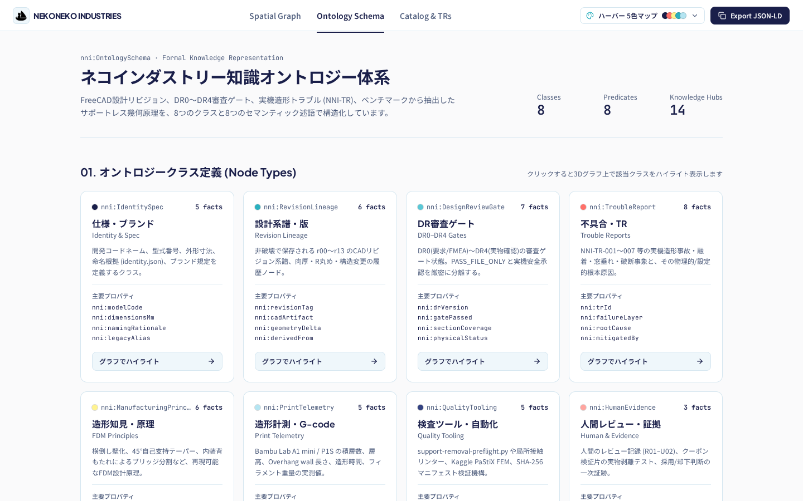
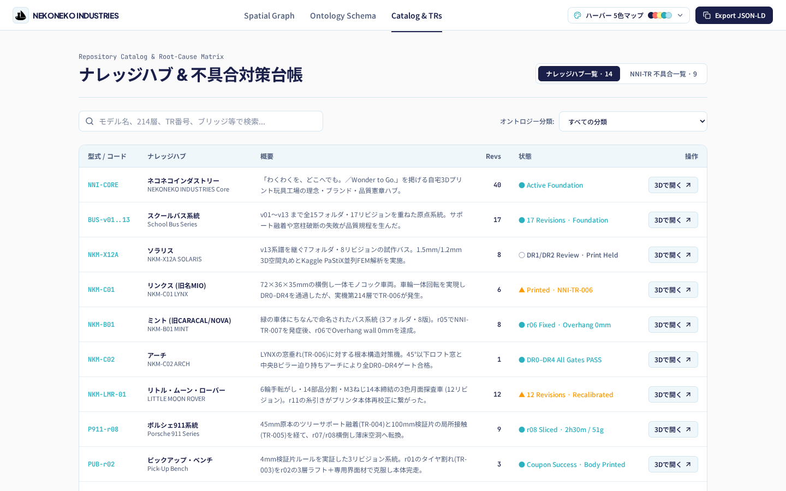

# NEKONEKO INDUSTRIES — 3D Knowledge Graph & Ontology

> 「わくわくを、どこへでも。 / Wonder to Go.」  
> **[Sunwood-ai-labs/NEKONEKO-INDUSTRIES](https://github.com/Sunwood-ai-labs/NEKONEKO-INDUSTRIES)** の FreeCAD 設計リビジョン、DR0〜DR4 設計審査体系、実機造形トラブル記録（NNI-TR）、およびサポートレス FDM 造形知見を、**3D 空間ナレッジグラフ＆形式オントロジー**として対話的に探索できる可視化アプリケーションです。



---

## 主な特徴・ビュー構成

| スケール | 収録データ |
| :--- | :--- |
| **Knowledge Hubs** | **14 ハブ**（中核 `NNI-CORE` + 車両・船舶・造形原理・DR・自動検査・命名ガバナンスの 13 ハブ） |
| **3D Graph Elements** | **173 ノード**（ハブ / オントロジー分類 / Fact リーフ / エビデンス末端 / 補助衛星）＆ **219 エッジ** |
| **Ontology Schema** | **8 クラス (`rdfs:Class`)** ＆ **8 セマンティック述語** |
| **Cross-Links** | **26 本のハブ間関係** ＋ **34 本のノード間セマンティック因果リンク** |
| **Trouble Ledger** | **9 件の実機トラブル＆対策記録**（`NNI-TR-001` 〜 `007` ほか） |

---

### 1. 3D Spatial Graph（`放射` モード ＆ `X整列` 3D 円錐モード）

HTML5 Canvas ベースの独自 3D 透視投影・被写界深度フォグエンジンにより、ハブから伸びる知識クラスターを立体的に探索できます。右上のトグルから 2 つの整列モードをアニメーション遷移で切り替えられます。

- **`放射`（Radial Starburst）**: 中核ハブ「ネコネコインダストリー (`NNI-CORE`)」の**太陽ロゴコア（公式ロゴ「38 ねこ船長」）**を中心に、全 14 ハブが 3D 星団状に展開します。
- **`X整列`（Ontology-X 3D 円錐）**: **X 軸のみ**を 8 つのオントロジークラスに厳密整列させ、Y・Z 軸は自由配置することで、`NNI-CORE` を頂点（Apex）として広がる **3D 円錐（Cone）** を形成します。`円錐ガイド` ボタンで断面リングと母線ガイドの ON/OFF 切替が可能です。



---

### 2. ノード間セマンティック因果リンク ＆ 暗色高視認性カラーマップ

ハブ同士の関係だけでなく、**個別のリーフノード同士を繋ぐ 34 本のセマンティックリンク**を内蔵しています。

- 不具合ノード（例: `リンクス` の `NNI-TR-006: 第214層 上側側窓の垂下`）をクリックまたはホバーすると、原因を共有する同種不具合（`ミント` `NNI-TR-007`）や、根本対策となった設計原理（`アーチ` `45°ロフトアーチ`）へ**因果リンクと関係ラベルがハイライト**されます。
- 黒地・紺地テーマでは、ノード輝度を自動ブーストして視認性を確保しています。



#### 切り替え可能な 6 種類のノードカラーマップ

| カラーマップ名 | テイスト | 背景トーン |
| :--- | :--- | :--- |
| **ハーバー 5色マップ** *(既定)* | `#1A1F4A` · `#FF7069` · `#FFF390` · `#2BB0BF` · `#B4E5F2` | ライト (`#FAFAFB`) |
| **オーシャン寒暖マップ** | 深海ネイビー〜シアン〜サンイエロー〜コーラルの寒暖グラデーション | ライト (`#FAFAFB`) |
| **ヴェイパーウェーブ・パームズ** | `#280D8C` · `#3711BF` · `#180E59` · `#070C26` · `#F24B4B` | ライト (`#FAFAFB`) |
| **ミッドナイト航海 (紺地)** | 紺地 (`#1A1F4A`) ＋ 高輝度 5 色ノード＆発光ハロー | ダーク (`#1A1F4A`) |
| **ヴェイパーウェーブ・ナイト (黒地)** | 漆黒紺 (`#070C26`) ＋ ネオン高視認ノード | ダーク (`#070C26`) |
| **クラシック (従来配色)** | プラム＆インディゴ基調のクラシック配色 | ライト (`#FAFAFB`) |

---

### 3. Inspector Drawer ＆ リーフノード Markdown プレビュー

グラフ上のノードまたはハブを選択すると右側にインスペクターが開き、**Fact / Evidence / Category / Satellite ノード単位の構造化 Markdown ビュー**をその場で閲覧できます。

- **Preview / Markdown (.md) 切替**: テーブル・Turtle トリプル表現・ブランドロゴ画像を含む構造化ドキュメントを表示
- **GitHub 原本を取得**: 対象ファイルの `raw.githubusercontent.com` 原文をワンクリックで取得してプレビュー可能
- **AI エージェント連携 & JSON-LD エクスポート**:
  - `Copy Knowledge Subgraph for AI Agent`: 選択ハブの仕様・TR・因果関係をプロンプト用 Markdown としてコピー
  - `Export JSON-LD`: 全オントロジー体系・14 ハブ・クロスリンクを `@context` 付き JSON-LD としてクリップボード出力（またはダウンロード）
- **コアシンボル切替 (`NNI-CORE`)**: 公式ロゴ（`38 ねこ船長`）、猫モノグラム、または任意のローカル画像アップロードに対応



---

### 4. Ontology Schema ＆ Catalog / TR Ledger

ヘッダーのナビゲーションから、3D グラフ以外の 2 つのリファレンスビューへ即座に切り替えられます。

<table>
  <tr>
    <td width="50%">
      <strong>Ontology Schema（オントロジー体系）</strong><br/>
      <sub>8 つの <code>rdfs:Class</code> 定義・主要プロパティ・8 つの述語（<code>derivedFrom</code>, <code>mitigatedBy</code> 等）を一覧でき、「グラフでハイライト」から 3D グラフの該当クラスへ直接ジャンプします。</sub>
      <br/><br/>
      
    </td>
    <td width="50%">
      <strong>Catalog &amp; TRs（ハブ＆不具合対策台帳）</strong><br/>
      <sub>全 14 ハブのリビジョン数・ステータス検索と、<code>NNI-TR-001〜007</code> の現象・根本原因・対策テーブルを切り替え表示し、「3Dで開く」から対象ハブへフォーカスします。</sub>
      <br/><br/>
      
    </td>
  </tr>
</table>

---

## 操作ガイド（3D ビュー）

| 操作 | 動作 |
| :--- | :--- |
| **ドラッグ** (`Rotate` モード) | 3D 空間の回転（Yaw / Pitch） |
| **`Shift` + ドラッグ**（または `Pan` モード） | 視点の平行移動 |
| **マウスホイール / `+` `-` ボタン** | ズームイン・ズームアウト |
| **矢印キー (`←` `→` `↑` `↓`)** | キーボードでのオービット回転 |
| **ノード / ハブをクリック** | インスペクター表示 ＋ 接続関係・セマンティックリンク強調 |
| **画面下部フィルタバー** | オントロジークラス別に 3D ノードを絞り込み |
| **`All Relations` / `Overview`** | クロスリンク全体の表示切替 / 全体俯瞰カメラへのリセット |

---

## 技術スタック

- **Frontend**: React 19, TypeScript, Vite 8
- **Styling & Icons**: Tailwind CSS v4, Lucide React
- **3D Rendering**: HTML5 Canvas 2D（カスタム 3D 透視投影・距離適応フォグ・アニメーション補間）
- **Tests**: Node.js built-in test runner + `tsx`

---

## ローカル開発・検証コマンド

```bash
# 1. 依存パッケージのインストール
npm install

# 2. 開発サーバー起動 (http://localhost:3000)
npm run dev

# 3. TypeScript 型チェック
npm run lint

# 4. グラフ構築・3D投影・パレット・X整列・セマンティックリンクの単体テスト
npx tsx --test src/utils/graphLayout.test.ts

# 5. 本番ビルド
npm run build
```

---

## ディレクトリ構成（抜粋）

```text
├── docs/images/                  # README 用スクリーンショット
├── public/brand/                 # 38 ねこ船長ロゴアセット
├── src/
│   ├── components/
│   │   ├── SpatialGraphCanvas.tsx # 3D グラフ描画（放射 / X整列円錐 / セマンティックリンク）
│   │   ├── InspectorDrawer.tsx    # ハブ・リーフ詳細、Markdown ビュー、AI 出力
│   │   ├── MarkdownPreview.tsx    # 構造化 Markdown レンダラー
│   │   ├── OntologySchemaView.tsx # オントロジークラス & 述語ビュー
│   │   ├── CatalogListView.tsx    # ハブ台帳 & NNI-TR 不具合一覧
│   │   └── TopBar.tsx             # ナビゲーション・6色カラーマップ切替・JSON-LD 出力
│   ├── data/
│   │   └── nekonekoOntology.ts    # 14 ハブ・8 クラス・26 ハブ間リンク・34 ノード間リンク
│   ├── types/knowledge.ts         # オントロジー & 3D グラフ型定義
│   └── utils/
│       ├── graphLayout.ts         # 3D 座標生成（放射 / 円錐 X整列）・投影・JSON-LD 変換
│       ├── graphLayout.test.ts    # 単体テストスイート
│       ├── nodeMarkdown.ts        # リーフノード構造化 Markdown & Turtle 生成
│       └── themePalettes.ts       # 6 種類のカラーマップ・輝度コントラスト制御
└── README.md
```

---

## 出典・関連リポジトリ

- データ出典: **[Sunwood-ai-labs/NEKONEKO-INDUSTRIES](https://github.com/Sunwood-ai-labs/NEKONEKO-INDUSTRIES)**
